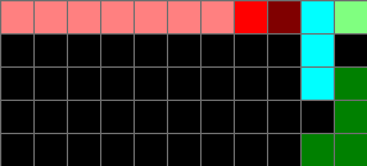
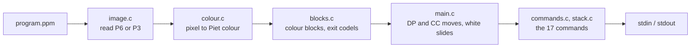

# piet-interpreter-c

An interpreter for [Piet](https://www.dangermouse.net/esoteric/piet.html), the language whose programs are
pictures, in plain C. It reads the program as a PPM image and runs it.



One of the test programs: it pushes 7 and 1, then `switch` turns the codel chooser right, so the cyan
column is left through its bottom codel into green, where `out(number)` prints `7`.



## Build and run

Needs a C99 compiler and make.

```
make
make test                        # also writes small programs into tests/build/
./piet tests/build/hello.ppm     # prints Hi
./piet -t tests/build/hello.ppm  # also prints every step on stderr
```

A trace line gives the step, the block left (colour and size), the block entered and where, the command, then DP,
CC and the stack:

```
1: light red (72) -> red at (72,0), push, now DP right CC left [72]
```

The program must be a PPM file, binary (P6) or plain (P3), with values up to 255 and one pixel per codel.
Programs found online are often PNG or GIF with bigger codels. With Pillow, this converts one whose codels are
`c` pixels wide:

```
python3 -c "import sys; from PIL import Image; im = Image.open(sys.argv[1]).convert('RGB'); c = int(sys.argv[3]); im.resize((im.width // c, im.height // c), Image.NEAREST).save(sys.argv[2])" in.png out.ppm c
```

## Choices where the spec leaves room

- **Colours**: a pixel must equal one of the 18 colours exactly. Besides the standard palette (channels 0x00,
  0xC0, 0xFF), two variants found in sample files are accepted, in any combination: 0x80 in place of 0xC0 (in
  light and dark colours), and 0x20 in place of 0x00. Any other pixel, even one unit off, counts as white if
  0.202 R + 0.707 G + 0.071 B is 128 or more, black otherwise.
- **Start**: top-left codel, DP right, CC left. If that codel is white the pointer slides from it; if it is
  black the program ends at once. A program ends after 8 blocked tries in a row; there is no step limit.
- **The image edge** blocks, like black.
- **White**: the pointer slides straight across. At black or the edge it toggles the CC and turns the DP
  clockwise. If it gets back to a white codel it already left in the same direction, it is going round forever
  and the program stops. No command runs across white.
- **A command that can't run** (too few values, division by zero, roll deeper than the stack or with a negative
  depth) is skipped and leaves the stack as it was.
- **Division** rounds down, and `mod` takes the sign of the divisor: with `a` the top value and `b` the one
  below, `b == a * (b / a) + b mod a`.
- **Input**: `in(number)` skips whitespace and reads an integer with an optional sign; if the input isn't a
  number, the command is skipped and what follows stays in the input. `in(char)` reads one UTF-8 character, spaces and
  newlines included. At the end of input both are skipped.
- **Output** has no prompts and no added newline. `out(char)` writes UTF-8 and skips values outside 0 to 0x10FFFF.
- **Values** are C `long` (64-bit on 64-bit Linux) and wrap around on overflow.

## Tests

`make test` needs Python 3 (standard library only). `tests/programs.py` writes 11 small programs into
`tests/build/`, each with its expected output: arithmetic, stack and roll, input, white, off-palette colours,
pointer, switch, the three palettes, and P6 and P3 files. `tests/run.sh` runs each one for up to 10 seconds and
compares its output byte for byte.

The runner also takes any program put in `tests/samples/`: `name.ppm`, the expected output `name.out` (exact
bytes, so no trailing newline unless the program prints one) and, if the program reads, `name.in`. That folder is
git-ignored: I used it for 16 classic programs by other authors, such as Hello world variants, 99 bottles, cowsay,
pi, Euclid, factorial and a text adventure; they can't be shared here. More programs are on the
[Piet samples page](https://www.dangermouse.net/esoteric/piet/samples.html).

All 27 pass, the 11 generated and the 16 samples: [raw output](docs/test-run.txt).

## Repository layout

| Path | Content |
|---|---|
| `Makefile` | `make` builds `piet`, `make test` runs the tests |
| `src/` | the interpreter |
| `tests/` | test program generator and runner |
| `docs/` | picture and test output |

## License

MIT, see [LICENSE](LICENSE).
